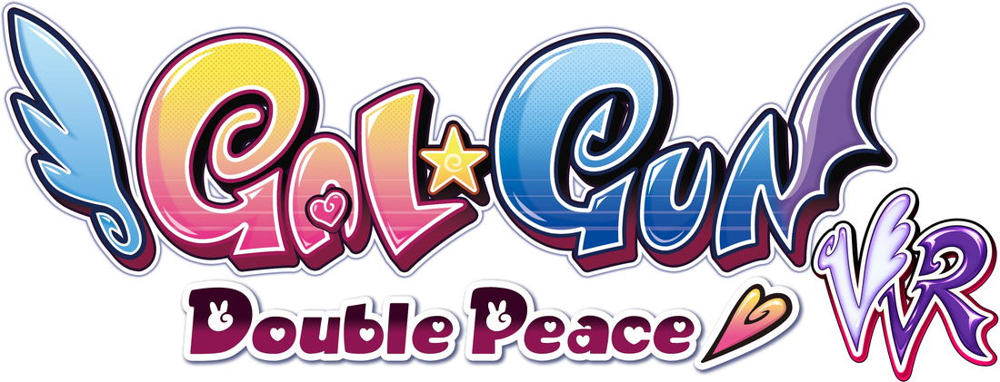

<p align="center">
  
</p>

<h1 align="center">GGDPVR</h1>
<p align="center"><b>Play Gal*Gun: Double Peace in VR</b> - full stereo 3D, head tracking and motion-controller aiming.</p>

---

GGDPVR is an unofficial fan mod for the PC version of **Gal\*Gun: Double Peace**. It shows the game in your VR headset
in true stereo 3D: you look around with your head, aim and shoot by pointing a VR controller, and the game's HUD and
menus float on a panel in front of you.

It works with any headset that supports OpenXR - Meta Quest (Link / Air Link), SteamVR headsets, Virtual Desktop,
Windows Mixed Reality, Pimax and others.

More mods, including a VR texture fix for DarkhawkZer02's Winter Passion mod pack (base game version), are listed at
**[jumph591.github.io](https://jumph591.github.io/)**.

## Features

- **Stereo 3D with head tracking** in stages, boss battles, minigames, cutscenes, the title screen, the hub, the
  Collection and the Dressing Room.
- **Motion-controller aiming**: point to aim, pull the trigger to shoot. Zoom, Doki Doki Mode, "Mom is coming!" and
  every other action are on the controllers, and all buttons can be remapped.
- **Point-and-click menus**: aim at any menu and pull the trigger; the right stick scrolls long lists.
- **The game's HUD on a floating panel**, with weak-spot pop-ups, name tags and boss markers placed in 3D at the girls -
  also on girls you turn your head to look at, outside the panel.
- **Minigames adapted for VR**: touch and rub with the grip, motion gestures with your hands or the thumbsticks.
- **Comfort options**: the game's hit shake and walking bob removed (on by default), recenter on a button.
- **Game sound in the headset**, kept playing when another window has the focus.
- **A small setup program** to install, repair, switch off and uninstall - it never touches the game's own files or
  your save data.
- **No network code**: the mod never connects to anything. Its log for bug reports stays on your PC.

## Requirements

- **Gal\*Gun: Double Peace for Windows.** Made and tested with the Steam version; another PC copy of the same game
  version should work too.
- **A PC VR headset** and the software that connects it to your PC, set as the active OpenXR runtime: Meta Quest Link /
  Air Link, SteamVR, Virtual Desktop, Windows Mixed Reality, Pimax Play, ...
- Windows 10 or 11, 64-bit. Nothing else to install - the mod even starts the game in DirectX 11 mode by itself.

## Install

### The easy way

1. Download **`GGDPVR-<version>.zip`** from the [Releases](../../releases) page and unpack it anywhere.
2. Run **`GGDPVR-Setup.exe`**. It finds a Steam copy of the game by itself; for other copies click *Change...* and pick
   the game folder (the one with the `Binaries` folder in it).
   If Windows shows "Windows protected your PC": click *More info*, then *Run anyway*.
3. Click **Install**.
4. Start your VR software, then start the game (from Steam, or the setup's *Start game* button).

`GGDPVR-Setup.exe` is also how you repair, switch the mod off and on, open your settings and logs, turn logging off
and on, and uninstall. It always keeps your settings.

### Updating

GGDPVR never checks for updates by itself - it has no network code. To update, download the new zip from
[Releases](../../releases) and run its `GGDPVR-Setup.exe`: it updates the installed mod and keeps your settings.
Watch the repository (*Watch > Custom > Releases*) to be told about new versions.

### By hand

Copy the zip's `Binaries` folder into the game folder (merge the folders). That adds exactly:

```
Binaries\Win64\dinput8.dll          the loader that starts the mod with the game
Binaries\Win64\GGDPVR\GGDPVR.dll    the mod
Binaries\Win64\GGDPVR\ggdpvr.ini    your settings
```

No game file is replaced. When updating by hand, keep your own `ggdpvr.ini`.

## Controls

What each button does in each part of the game. These are the defaults for a right-handed player on **Meta Quest
controllers**. Left-handed (`dominant_hand=left`): the triggers, grips and thumbsticks swap hands; A, B, X and Y stay
where they are. Every button can be changed in the `[controls]` section of the settings file.

### Everywhere

| What | Button |
|---|---|
| Pause | left menu button (☰) |
| Re-center the view (your headset's own re-center works too) | press the left thumbstick down |

### Stages and boss battles

| What | Button |
|---|---|
| Aim | point your right controller |
| Pheromone shot - hold it to charge a stronger shot | right trigger |
| Zoom - hold it to see through obstacles | right grip |
| Start Doki-Doki Mode (needs at least one full Heart Gauge) | Y |
| Mom is coming! (the quick-hide screen) | X |
| Choose your route at the arrows | left thumbstick |
| Hide / show the HUD, to see a girl up close | B |
| Sight speed - the game's setting for moving the sight with a stick: no effect when you aim with the controller | left grip |

In boss battles, the "!" markers of a boss's special attack are shot like everything else: point and pull the trigger.

### Doki-Doki Mode (in a stage)

| What | Button |
|---|---|
| Choose a girl: point at the marker on her and pull the trigger | right trigger |
| Touch her gently: tap | right trigger |
| Rub: hold it down | right trigger |
| Change the camera angle (more cameras are sold in the Academy Store) | left / right grip |
| Euphoria | Y |

### Final Doki-Doki Mode (end of a route)

| What | Button |
|---|---|
| Aim at a spot (head, chest, ...) | point your right controller |
| Zoom in and shoot: hold to zoom in, let go to shoot | right grip |
| Quick shot, without zooming | right trigger |
| Euphoria, when her gauge is full | Y |

### Minigames

The HUD panel moves up and down with your gaze, so it is always where you look.

| What | Button |
|---|---|
| **Targets:** shoot the hidden targets all over her before the time runs out - they show inside your sight's circle | right trigger |
| **Special requests:** heart icons under the Satisfaction Gauge mean she wants something - follow her voice to the request icon on her body. Point at it so it shows inside your sight's circle, then tap to poke, hold and move your hand to rub, hold still to hold, or hold and swipe to flick | right grip |
| **Hands-on:** when the Satisfaction Gauge is full, repeat the on-screen commands as fast as you can - hold and move your hand the way the game shows (drag up / down, circle, scratch) | right grip, or either trigger |
| ...or do the hands-on commands with the thumbsticks: circles and scratching with the right stick, the two-handed up / down drags with either stick | thumbsticks |

### Menus, the hub and story scenes

The pointer stays on a menu while it is up, wherever the controller points.

| What | Button |
|---|---|
| Click what you point at | right trigger |
| Confirm / back | A / B |
| Move through a menu | left thumbstick |
| Scroll long lists (in the pause menu, Continue and results screens it moves through the items instead) | right thumbstick |
| Switch tabs, in menus that have them | left / right grip |
| Story scenes: next line | right trigger or A |

### Collection, Dressing Room and the story game-over screen

| What | Button |
|---|---|
| Turn the camera | right thumbstick |

In the Collection's *Fantasize*:

| What | Button |
|---|---|
| Move the camera | left thumbstick |
| Tilt | right thumbstick |
| Glasses | press the right thumbstick down |
| Pose | A |
| Doki-Doki | Y |
| Zoom in and out - you move closer to her or back | left / right grip |
| Reset the zoom | both grips |
| Touch | left trigger |
| Back | B |

Valve Index, HTC Vive, Windows Mixed Reality, HP Reverb G2 and Steam Frame controllers are supported too - the settings
file explains where their buttons are. To play with a gamepad or mouse and keyboard while still seeing the game in VR,
set `controllers=0`.

> **Quest / Rift controllers through SteamVR** (Steam Link, Virtual Desktop in SteamVR mode): SteamVR takes the left
> menu button for its own menu, so set another pause button, e.g. `pause=main.stick_click` in `[controls]`, or rebind
> it in SteamVR's controller settings.

## Settings

Everything is in one file, `Binaries\Win64\GGDPVR\ggdpvr.ini` in the game folder. Every option is explained there and
shows its default; changes apply the next time you start the game. The everyday options come first (HUD panel size
and distance, weak-spot pop-up size, comfort, audio), then the controller buttons in `[controls]`, then `[advanced]`.

To go back to the defaults, delete `ggdpvr.ini` and click *Repair* in the setup.

## Playing without VR / uninstalling

- *Turn mod off* in the setup: the game starts as if the mod wasn't installed. *Turn mod on* brings VR back.
  (By hand: create an empty file called `disabled` in the `GGDPVR` folder.)
- *Uninstall* in the setup removes everything the mod added. By hand: delete `dinput8.dll` and the `GGDPVR` folder
  from `Binaries\Win64`.

While VR runs, the mod temporarily changes a few of the game's graphics settings (for example motion blur,
anti-aliasing and the resolution) and puts your own values back when the game closes - after a crash, the next start with the mod
puts them back. Before uninstalling by hand after a crash, start the game once and quit normally.

## Recording and streaming

Recording tools that capture the headset view (for example the *OpenXR OBS Mirror* layer) work with the mod.
Capture **one eye** rather than both - a blend of both eyes looks doubled.

## Troubleshooting

- **Nothing in the headset**: start your VR software before the game, and make sure it is the active OpenXR runtime
  (SteamVR: *Settings > OpenXR*; Meta Quest Link: *Settings > General > OpenXR Runtime*).
- **The game stays on the monitor only**: check that `enabled=1` in `ggdpvr.ini` and that there is no `disabled` file
  in the `GGDPVR` folder, then click *Repair* in the setup.
- **The game crashes when choosing your character at New Game**: this can happen without the mod too, after other mods
  (for example costume packs) have changed the game's files. Restore the original game files (Steam: *Verify integrity
  of game files*), then reinstall GGDPVR with the setup's *Repair*.
- **Reporting a problem**: play until it happens, quit, and attach `%LOCALAPPDATA%\GGDPVR\logs\ggdpvr.log` (the
  setup's *Log folder* opens it; `ggdpvr.prev.log` is the session before) to an [issue](../../issues). Say which
  headset and VR software you use, and your operating system if it isn't Windows. If you turned logging off, turn it
  back on first (*Turn logging on* in the setup, or `log=1` in `ggdpvr.ini`). The log never contains your user name
  or device names.

## Known limitations

- **Performance**: the game's rendering cost is per view, so busy stages can run at half your headset's refresh rate on
  mid-range GPUs. A lower refresh rate (72 / 80 Hz on Quest) gives the most headroom. Reports from other setups are
  welcome.
- Steam Frame controller bindings follow Valve's input documentation but are untested on real hardware.
- Reports from other headsets and setups are welcome.

## Building from source

Requirements:

- **Visual Studio 2022 Build Tools** with *Desktop development with C++* (MSVC v143, a Windows 10/11 SDK, and the
  CMake + Ninja components). The build script expects the default install location.
- **Python 3** (optional): checks that the UI shader compiles before building.

```bat
build.bat                                 :: -> out\RelWithDebInfo\  (dinput8.dll, GGDPVR.dll, GGDPVR-Setup.exe)
powershell -File package\make_package.ps1 :: -> dist\GGDPVR-<version>\ and dist\GGDPVR-<version>.zip
```

`install\install.ps1 -KeepIni` copies a fresh build into a Steam install of the game (developer use).

Layout:

| Folder | Contents |
|---|---|
| `loader/` | the `dinput8.dll` proxy that loads the mod (and forces DirectX 11 / a DXGI 1.1 factory) |
| `src/` | the mod: `xr/` OpenXR session, swapchains, input; `vr/` stereo, HUD panel, controllers, minigames; `ue3/` Unreal Engine 3 reflection and hooks; `core/` config, logging, hooks |
| `config/` | the settings file template |
| `package/` | the setup program and the player README |
| `third_party/` | OpenXR SDK (loader + headers), MinHook, RenderDoc app header |
| `docs/` | [technical notes](docs/TECHNICAL.md) |

## Privacy

GGDPVR has no network code: it never connects to the internet and never sends anything anywhere. For bug reports it
keeps a log of the last few game sessions on your PC (`%LOCALAPPDATA%\GGDPVR\logs`, at most 100 MB per session). The
log never contains your Windows user name or device names, and it only leaves your PC if you send it yourself.
*Turn logging off* in the setup (or `log=0` in `ggdpvr.ini`) stops it.

## License

GGDPVR is released under the [MIT License](LICENSE). Third-party components keep their own licenses - see
[THIRD_PARTY_NOTICES.md](THIRD_PARTY_NOTICES.md).

## Disclaimer

GGDPVR is an unofficial fan project, not affiliated with or endorsed by INTI CREATES, PQube or any other rights holder.
Gal\*Gun: Double Peace and its logo are trademarks of their respective owners; the GGDPVR logo is fan art based on the
game's logo. The mod contains no game files - you need your own copy of the game.
